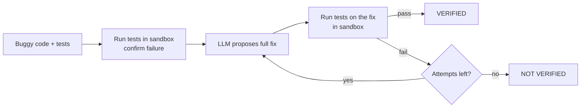
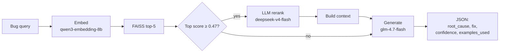
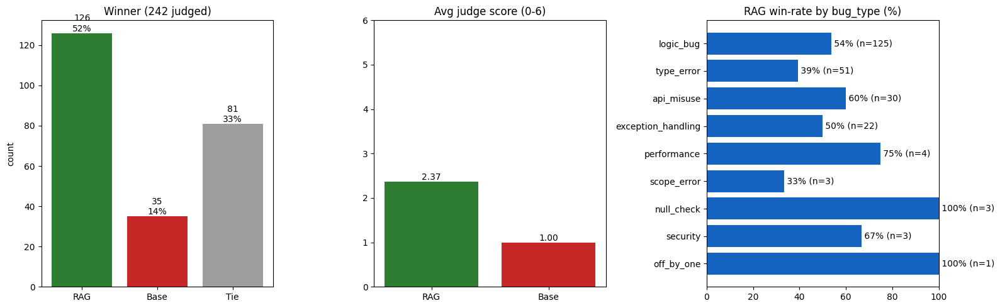
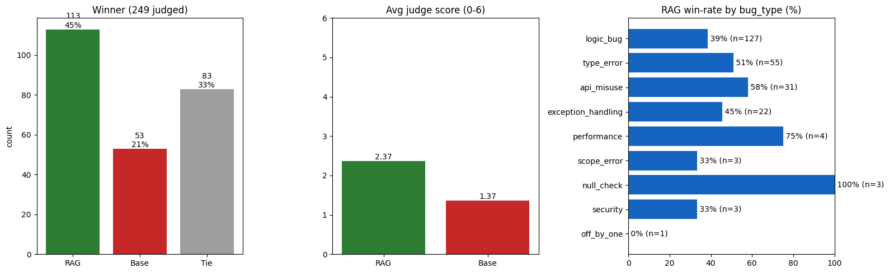
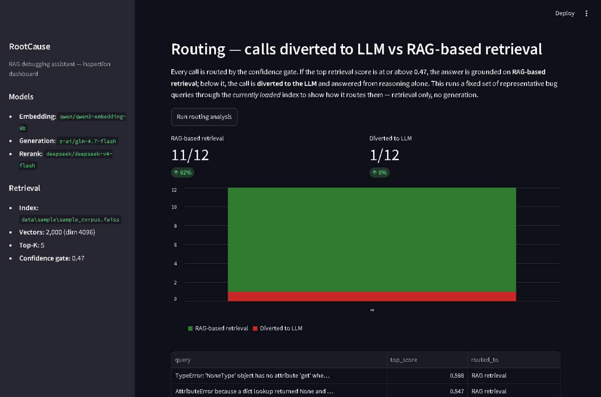

# BugVertex AI

**Find the bug. Write the fix. Prove it works.**

BugVertex AI is a debugging assistant that does not just *suggest* a fix: it **checks the fix by
running your tests in a sandbox**. Only a patch that passes is marked **VERIFIED**.

> **Attribution.** This project extends the open-source, MIT-licensed project
> [RootCause](https://github.com/nanusaksham6/RootCause-Analysis) by Saksham Katna.
> The original license and copyright notice are kept in [LICENSE](LICENSE).
> Extensions in this repository are by priyadarshini116.

## The problem

Debugging eats hours. AI assistants can suggest fixes that look right but are wrong, and
developers still have to check every one by hand.

## The answer

1. **Paste** your buggy code and tests that describe correct behavior.
2. BugVertex runs the tests and shows **the error** they found.
3. It explains the **root cause**, using similar historical bug fixes as evidence when it finds a close match.
4. It writes a **fix**, runs your tests on it in a sandbox, and retries with feedback (up to 3 attempts) if the fix fails.
5. You get a **proof**: a VERIFIED or NOT VERIFIED verdict, the exact patch, and a log of what happened.

Built for developers, QA engineers and students learning to debug.

## Quickstart (PowerShell)

```powershell
git clone https://github.com/YOUR-USERNAME/BugVertex-AI.git
cd BugVertex-AI

python -m venv .venv
.\.venv\Scripts\Activate.ps1
pip install -r requirements.txt

# Add your OpenRouter key
Copy-Item .env.example .env
# then edit .env and set OPENROUTER_API_KEY=sk-or-v1-...

python -m streamlit run src\dashboard.py
```

macOS / Linux: `python3 -m venv .venv && source .venv/bin/activate`, then `cp .env.example .env`.

Open the address Streamlit prints (usually `http://localhost:8501`). Pick an example bug from the
dropdown (or paste your own code and tests) and click **Find the bug and fix it**.

## The dashboard

- **Main page:** paste code and tests, then watch the four stages: error found, root cause, fix written, proven by tests.
- **How it works:** the repair loop as a diagram.
- **Proof:** results on the 20-bug benchmark, including the one miss.
- **Search past bugs** and **Routing:** the inherited retrieval tools (see below).

## What I inherited vs. what I built

**Inherited from the original RootCause project**
- Retrieval pipeline: embeddings + FAISS search (`src/core.py`)
- Confidence gate (threshold 0.47) and optional LLM reranking
- Grounded JSON answer generation
- MCP server (`src/bugvertex_server.py`, renamed from `rootcause_server.py`)
- The original dashboard's "Search past bugs" and "Routing" features
- Bundled sample bug-fix corpus and index (`data/sample/`)
- Threshold calibration script and the evaluation in the "Inherited evaluation" section below

**Built by me**
- `benchmark/bugs/`: 20 small Python bugs (None errors, type errors, off-by-one, SQL injection, missing timeout, and more). Each has buggy code, a known fix, tests and metadata.
- `src/sandbox.py`: runs code and tests in a throwaway folder with a time limit and a clean environment (API keys are not passed in).
- `src/patcher.py`: asks the LLM for a fix, verifies it in the sandbox, and retries up to 3 times, showing the model its previous failed attempt. Also returns the original test failure so the dashboard can show the error.
- `src/dashboard.py` and `src/fx.py`: a redesigned dashboard built around the flow error, root cause, fix, proof, with a patch diff drawing, an animated repair-loop diagram and a replayed session log.
- `scripts/run_benchmark.py`: checks that every benchmark bug fails with its bug and passes with its known fix.
- `scripts/run_patch_eval.py`: measures how many AI patches are verified.
- `scripts/debug_bug.py`: shows exactly what the model replied and how the tests reacted.

## How patch verification works



The model is shown the buggy code, the tests and the failure output, never the known fix.
If a patch fails, the retry prompt includes the failed patch so the model does not repeat it.

## Results (my benchmark)

Model: `z-ai/glm-4.7-flash` via OpenRouter. 20 bugs, up to 3 attempts each.

| Run | Verified fixes | Verified on first try |
|-----|----------------|-----------------------|
| 1 (before the retry prompt showed the previous patch) | 19 / 20 (95%) | 17 / 20 (85%) |
| 2 (after) | 19 / 20 (95%) | 18 / 20 (90%) |

The benchmark itself is checked first: all 20 bugs fail with the bug and pass with the known
fix (20 / 20 valid).

**The one failure, in both runs, is `bug_018` (missing timeout).** The model kept writing
`timeout=None`, which looks like a timeout but means "no timeout". The tests caught it. This is
the reason patches are verified by running tests instead of being trusted.

## Limitations

- The benchmark is small, hand-written and simple. These numbers do not show how the system performs on real-world codebases.
- The model sees the tests when it writes a patch, so "verified" means "passes these tests", not "correct in every situation".
- Model output varies between runs, and the 17 vs. 18 first-try difference is within that noise. I do not claim the retry change improved it.
- The sandbox is a separate process with a timeout and a clean environment. It is **not** a security boundary against hostile code. The dashboard runs pasted code on your own computer, so only use it with code you trust. Docker isolation is planned before any public deployment.
- The root-cause explanation uses the inherited retrieval pipeline. I have not independently evaluated its accuracy, nor verified the size or source of the bundled retrieval corpus; those details come from the original project.

## Roadmap

- Docker-based sandbox (no network, memory limit) so the app can be hosted publicly
- A demo mode that only runs the benchmark bugs
- Evaluation on real-world bugs and repeated runs for steadier numbers

## Reproduce my results

```powershell
python -m pip install -r requirements.txt
Copy-Item .env.example .env        # then add your OpenRouter key to .env
python scripts\run_benchmark.py    # validates the 20 benchmark bugs
python scripts\run_patch_eval.py   # AI patches + sandbox verification (calls the LLM)
```

Results are saved to `benchmark/results/`.

---

# Inherited foundation (from RootCause)

The sections below describe the original retrieval pipeline this project builds on.

RootCause is a retrieval-augmented debugging assistant that ships as an **MCP tool**. Give
it a bug report, traceback, or code snippet and it retrieves similar historical bug fixes
from a FAISS vector index, gates on retrieval confidence, optionally reranks the matches
with an LLM, and returns a grounded JSON answer: root cause, concrete fix, confidence, and
the examples it used. It runs out of the box against a bundled ~2,000-example sample
corpus; point it at your own corpus by setting two environment variables.

## Architecture



All retrieval, rerank and generation logic lives in [`src/core.py`](src/core.py). The MCP server
([`src/bugvertex_server.py`](src/bugvertex_server.py)) and the Streamlit dashboard
([`src/dashboard.py`](src/dashboard.py)) are thin callers of that one module.

| Component | Model | Notes |
|---|---|---|
| Embedding | `qwen/qwen3-embedding-8b` | Must match the model the index was built with (dim 4096) |
| Reranking | `deepseek/deepseek-v4-flash` | Reorders top-5 candidates; reasoning effort `low` |
| Generation | `z-ai/glm-4.7-flash` | Grounded JSON answer; reasoning disabled |
| Confidence gate | `0.47` | Calibrated empirically, see [CALIBRATION.md](CALIBRATION.md) |

## Bring your own data

The sample index is built from `data/sample/sample_bug_corpus.jsonl` by
[`scripts/build_index.py`](scripts/build_index.py). To rebuild it, or to build an index
from your own corpus:

```powershell
# Rebuild the bundled sample from its JSONL (~2,000 embedding calls, no LLM parsing)
python scripts\build_index.py --input data\sample\sample_bug_corpus.jsonl --output data\sample\sample_corpus.faiss

# Build from your own corpus and point the server/dashboard at it
python scripts\build_index.py --input my_bugs.jsonl --output data\my_corpus.faiss
$env:FAISS_INDEX_PATH="data\my_corpus.faiss"
$env:METADATA_PATH="data\my_corpus_metadata.pkl"
```

`build_index.py` auto-detects each input row: rows that are already labeled (have
`bug_type` + `issue` + `fix`) are normalized directly with no LLM call; rows that are raw
diffs (title + patches, no labels) are parsed by an LLM into the structured schema. Pass
multiple files to `--input` to mix sources, and `--max-samples N` to cap rows per file for
a cheap dry run.

After changing the embedding model or corpus, re-run
[`scripts/calibrate_threshold.py`](scripts/calibrate_threshold.py) to re-pick the
confidence gate (see [CALIBRATION.md](CALIBRATION.md)).

## MCP server

The MCP server speaks MCP over stdio, so it is meant to be launched by an MCP client rather
than opened in a browser:

```powershell
python src\bugvertex_server.py
```

Register it with any MCP-compatible client. Adjust the path to wherever you cloned the repo:

```json
{
  "mcpServers": {
    "bugvertex": {
      "command": "python",
      "args": ["C:\\path\\to\\BugVertex-AI\\src\\bugvertex_server.py"],
      "env": {
        "OPENROUTER_API_KEY": "sk-or-v1-your-key-here"
      }
    }
  }
}
```

The server exposes one tool:

```
analyze_bug(query: str) -> str   # returns JSON: {root_cause, fix, confidence, examples_used}
```

## Inherited evaluation (original project, not my work)

These results come from the original RootCause project. I have not reproduced them.

Per the original author: answers were generated with `z-ai/glm-4.7-flash` and judged by
`deepseek/deepseek-v4-pro` (LLM-as-judge: head-to-head winner vs an LLM-only baseline, plus a
0 to 6 quality score) on about 240 held-out bugs. The ablation is the confidence gate itself:
**on** (weak-retrieval queries go to the LLM) vs **off** (always ground on retrieval).

**Gate ON (shipped config).** 242 judged: RAG 52% / tie 33% / baseline 14%; average judge
score 2.37 vs 1.00.



**Gate OFF (pure RAG).** 249 judged: RAG 45% / tie 33% / baseline 21%; average judge score
2.37 vs 1.37.



**Routing on the bundled index.** A representative set of 12 bug queries routes as 11/12
(92%) retrieval-grounded and 1/12 (8%) diverted to the LLM. This is a routing distribution,
not a bug-fixing accuracy score.



See [CALIBRATION.md](CALIBRATION.md) for how the `0.47` gate threshold was chosen.

## Repo map

```
BugVertex-AI/
  README.md
  LICENSE
  CALIBRATION.md
  .gitignore
  .env.example
  requirements.txt
  .streamlit/
    config.toml           # NEW: dashboard theme
  src/
    core.py               # inherited: retrieval + rerank + generation
    bugvertex_server.py   # inherited: MCP server (renamed)
    dashboard.py          # redesigned: error -> root cause -> fix -> proof
    fx.py                 # NEW: dashboard visual effects (radar, session log)
    sandbox.py            # NEW: sandboxed test runner
    patcher.py            # NEW: patch generation + verification loop
  scripts/
    build_index.py        # inherited: JSONL corpus -> FAISS index
    calibrate_threshold.py# inherited: confidence-gate calibration
    run_benchmark.py      # NEW: validates the benchmark bugs
    run_patch_eval.py     # NEW: measures verified AI patches
    debug_bug.py          # NEW: inspect one bug's attempt
  benchmark/
    bugs/                 # NEW: 20 bugs (buggy.py, fixed.py, test_bug.py, meta.json)
    results/              # NEW: self_check.json, patch_eval.json
  data/sample/            # inherited: sample corpus and FAISS index
  images/                 # inherited: evaluation charts
  tests/
    test_smoke.py         # inherited: index alignment + one live retrieve() call
```

## Tests

```powershell
pytest tests\
```

The alignment check runs with no API key or network. The retrieval check makes a single
live embedding call and is skipped automatically when `OPENROUTER_API_KEY` is unset.

## License

MIT, see [LICENSE](LICENSE). Original work © 2026 Saksham Katna.
Extensions © 2026 priyadarshini116.