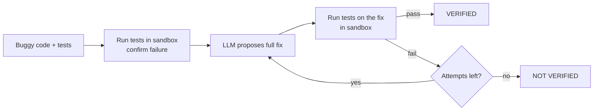
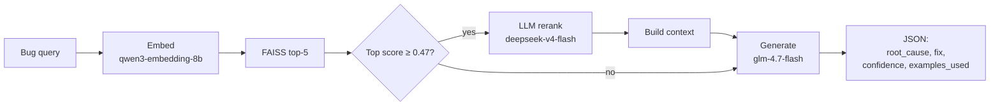

# BugVertex AI

AI-assisted bug investigation with **sandbox-verified patches**.

BugVertex AI retrieves similar historical bug fixes, gates on retrieval confidence, and
generates a grounded root-cause analysis. On top of that, it can propose a code patch and
**check it by running tests in a sandbox**, retrying with feedback if the first fix fails.

> **Attribution.** This project extends the open-source, MIT-licensed project
> [RootCause](https://github.com/nanusaksham6/RootCause-Analysis) by Saksham Katna.
> The original license and copyright notice are kept in [LICENSE](LICENSE).
> Extensions in this repository are by Priyadarshini M N.

## What I inherited vs. what I built

**Inherited from the original RootCause project**
- Retrieval pipeline: embeddings + FAISS search (`src/core.py`)
- Confidence gate (threshold 0.47) and optional LLM reranking
- Grounded JSON answer generation
- Streamlit dashboard (`src/dashboard.py`) and MCP server (`src/bugvertex_server.py`, renamed from `rootcause_server.py`)
- Bundled sample bug-fix corpus and index (`data/sample/`)
- Threshold calibration script and the evaluation in the "Inherited evaluation" section below

**Built by me**
- `benchmark/bugs/`: 20 small Python bugs (None errors, type errors, off-by-one, SQL injection, missing timeout, and more). Each has buggy code, a known fix, tests and metadata.
- `src/sandbox.py`: runs code and tests in a throwaway folder with a time limit and a clean environment (API keys are not passed in).
- `src/patcher.py`: asks the LLM for a fix, verifies it in the sandbox, and retries up to 3 times, showing the model its previous failed attempt.
- `scripts/run_benchmark.py`: checks that every benchmark bug fails with its bug and passes with its known fix.
- `scripts/run_patch_eval.py`: measures how many AI patches are verified.
- `scripts/debug_bug.py`: shows exactly what the model replied and how the tests reacted.

## How patch verification works



The model is shown the buggy code, the tests and the failure output, never the known fix.
If a patch fails, the retry prompt includes the failed patch so the model does not repeat it.

## Results (my benchmark)

Model: `z-ai/glm-4.7-flash` via OpenRouter. 20 bugs, up to 3 attempts each.

| Run | Verified fixes | Verified on first try |
|-----|----------------|-----------------------|
| 1 (before the retry prompt showed the previous patch) | 19 / 20 (95%) | 17 / 20 (85%) |
| 2 (after) | 19 / 20 (95%) | 18 / 20 (90%) |

The benchmark itself is checked first: all 20 bugs fail with the bug and pass with the known
fix (20 / 20 valid).

**The one failure, in both runs, is `bug_018` (missing timeout).** The model kept writing
`timeout=None`, which looks like a timeout but means "no timeout". The tests caught it. This is
the reason patches are verified by running tests instead of being trusted.

## Limitations

- The benchmark is small, hand-written and simple. These numbers do not show how the system performs on real-world codebases.
- The model sees the tests when it writes a patch, so "verified" means "passes these tests", not "correct in every situation".
- Model output varies between runs, and the 17 vs. 18 first-try difference is within that noise. I do not claim the retry change improved it.
- The sandbox is a separate process with a timeout and a clean environment. It is **not** a security boundary against hostile code. Docker isolation is planned before running any user-submitted code.
- I have not independently verified the size or source of the bundled retrieval corpus; those details come from the original project.
- The dashboard does not yet display patch verification (planned).

## Reproduce my results

```powershell
python -m pip install -r requirements.txt
Copy-Item .env.example .env        # then add your OpenRouter key to .env
python scripts\run_benchmark.py    # validates the 20 benchmark bugs
python scripts\run_patch_eval.py   # AI patches + sandbox verification (calls the LLM)
```

Results are saved to `benchmark/results/`.

---

# Inherited foundation (from RootCause)

The sections below describe the original retrieval pipeline this project builds on.

RootCause is a retrieval-augmented debugging assistant that ships as an **MCP tool**. Give
it a bug report, traceback, or code snippet and it retrieves similar historical bug fixes
from a FAISS vector index, gates on retrieval confidence, optionally reranks the matches
with an LLM, and returns a grounded JSON answer: root cause, concrete fix, confidence, and
the examples it used. It runs out of the box against a bundled ~2,000-example sample
corpus; point it at your own corpus by setting two environment variables.

## Architecture



All retrieval, rerank and generation logic lives in [`src/core.py`](src/core.py). The MCP server
([`src/bugvertex_server.py`](src/bugvertex_server.py)) and the Streamlit dashboard
([`src/dashboard.py`](src/dashboard.py)) are thin callers of that one module.

| Component | Model | Notes |
|---|---|---|
| Embedding | `qwen/qwen3-embedding-8b` | Must match the model the index was built with (dim 4096) |
| Reranking | `deepseek/deepseek-v4-flash` | Reorders top-5 candidates; reasoning effort `low` |
| Generation | `z-ai/glm-4.7-flash` | Grounded JSON answer; reasoning disabled |
| Confidence gate | `0.47` | Calibrated empirically, see [CALIBRATION.md](CALIBRATION.md) |

## Quickstart (PowerShell)

```powershell
git clone https://github.com/YOUR-USERNAME/BugVertex-AI.git
cd BugVertex-AI

python -m venv .venv
.\.venv\Scripts\Activate.ps1
pip install -r requirements.txt

# Configure your OpenRouter key
Copy-Item .env.example .env
# then edit .env and set OPENROUTER_API_KEY=sk-or-v1-...

# Run the MCP server against the bundled sample data
python src\bugvertex_server.py
```

macOS / Linux: `python3 -m venv .venv && source .venv/bin/activate`, then `cp .env.example .env`.

The server speaks MCP over stdio, so it is meant to be launched by an MCP client (see below)
rather than opened in a browser. The bundled sample index (`data/sample/`) is committed, so
retrieval works immediately. You only need `OPENROUTER_API_KEY` for the live embedding and
generation calls.

## Bring your own data

The sample index is built from `data/sample/sample_bug_corpus.jsonl` by
[`scripts/build_index.py`](scripts/build_index.py). To rebuild it, or to build an index
from your own corpus:

```powershell
# Rebuild the bundled sample from its JSONL (~2,000 embedding calls, no LLM parsing)
python scripts\build_index.py --input data\sample\sample_bug_corpus.jsonl --output data\sample\sample_corpus.faiss

# Build from your own corpus and point the server/dashboard at it
python scripts\build_index.py --input my_bugs.jsonl --output data\my_corpus.faiss
$env:FAISS_INDEX_PATH="data\my_corpus.faiss"