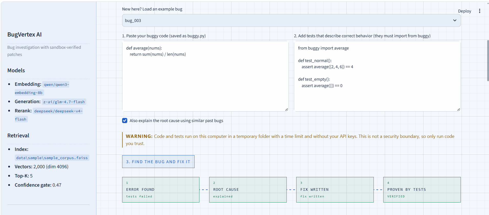
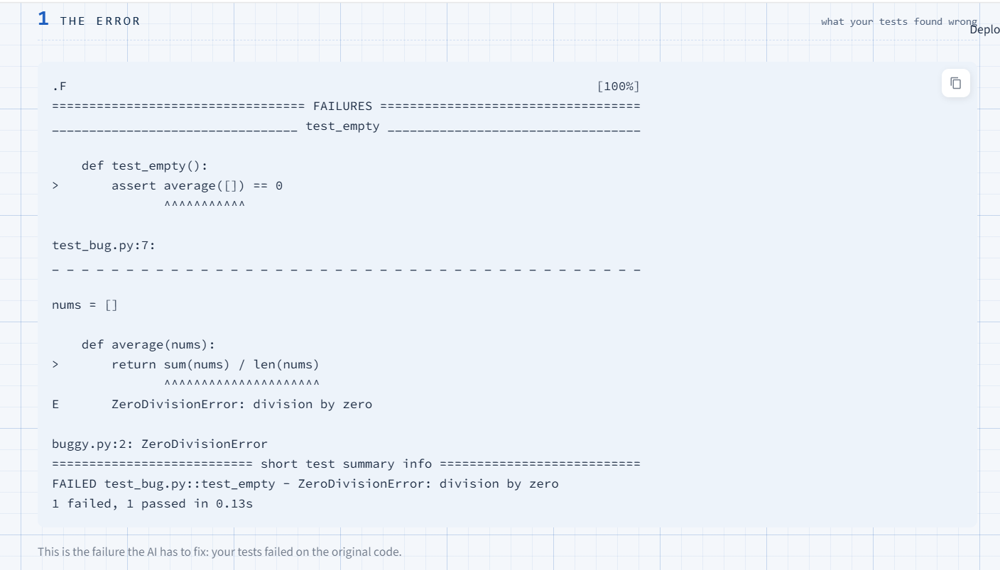
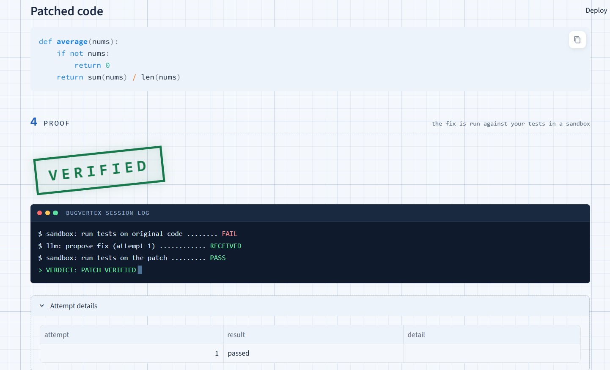
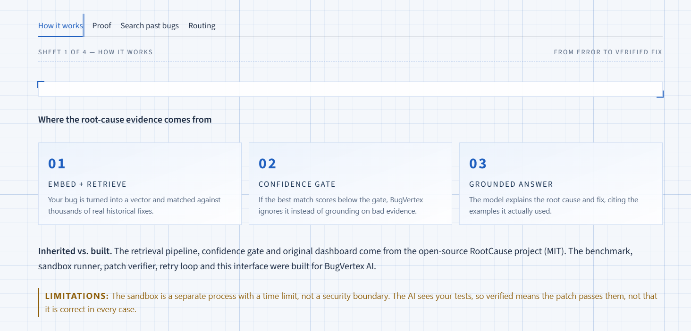
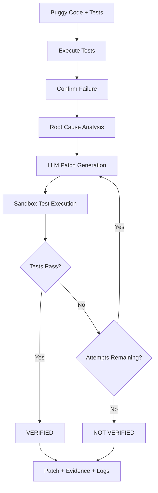

# BugVertex AI

**Find the bug. Write the fix. Prove it works.**

BugVertex AI is an intelligent debugging assistant that goes beyond suggesting code fixes. It generates patches, executes tests in a sandboxed environment, and determines whether the proposed fix passes the provided tests.

A patch is marked **VERIFIED** only when it passes the tests.

## Overview

Debugging can consume hours of development time. AI assistants may suggest fixes that appear correct but fail when executed.

BugVertex AI addresses this problem through an evidence-driven debugging workflow:

1. **Detect** — Run tests against buggy code to confirm the failure.
2. **Investigate** — Analyze the root cause using the error output and historical bug-fix retrieval.
3. **Repair** — Generate a candidate code patch using an LLM.
4. **Verify** — Execute the tests against the proposed fix in a sandbox.
5. **Report** — Display the verification verdict, patch, and execution log.

If a patch fails, the system can retry with feedback from the previous failed attempt, up to three attempts.

## Application Screenshots

<!-- Add screenshots to the screenshots/ directory using the filenames below. -->

### Dashboard


### Bug Investigation


### Patch Generation


### Verification Results


### Benchmark Evaluation


## Key Features

- AI-assisted root-cause analysis
- Automated bug reproduction using provided tests
- LLM-based patch generation
- Sandbox-based test execution
- Iterative patch repair with feedback
- VERIFIED / NOT VERIFIED verdicts
- Patch diff visualization
- Execution logs and failure evidence
- Historical bug-fix retrieval using embeddings and FAISS
- Benchmark evaluation for patch verification

## Architecture



The model receives the buggy code, tests, and failure output. The known correct fix is not provided to the model during patch generation.

## Technology Stack

| Technology | Purpose |
|---|---|
| Python | Core application logic |
| Streamlit | Interactive dashboard |
| FAISS | Similarity search over historical bug fixes |
| Embeddings | Semantic retrieval of related bugs |
| OpenRouter API | LLM access for patch generation and analysis |
| Pytest | Automated test execution |
| Sandbox execution | Isolated temporary execution environment |
| Mermaid | Architecture visualization |

## Benchmark Results

BugVertex AI was evaluated on a hand-written benchmark containing 20 Python bugs.

**Model:** `z-ai/glm-4.7-flash` via OpenRouter  
**Maximum attempts:** 3 per bug

| Evaluation | Verified Fixes | First-Try Verified |
|---|---:|---:|
| Run 1 | 19 / 20 (95%) | 17 / 20 (85%) |
| Run 2 | 19 / 20 (95%) | 18 / 20 (90%) |

The benchmark itself was validated: all 20 bugs failed with the buggy implementation and passed with their known fixes.

The remaining failure involved a missing timeout. The model repeatedly generated `timeout=None`, which does not enforce a timeout. The tests correctly rejected the patch.

These results demonstrate the value of test-based verification rather than trusting generated code.

### Evaluation Limitations

- The benchmark contains only 20 small, hand-written bugs.
- Passing the supplied tests does not guarantee correctness in every possible scenario.
- Model outputs can vary between runs.
- The retry improvement has not been established as statistically significant.
- The sandbox is not a security boundary against hostile code.

## Project Contributions

### Features Developed

- Created a 20-bug Python benchmark with buggy code, known fixes, tests, and metadata.
- Implemented sandbox execution with time limits and a clean environment.
- Developed an LLM-based patch generation and verification loop.
- Implemented retry feedback using previous failed patches.
- Redesigned the Streamlit dashboard around the error → root cause → fix → proof workflow.
- Added patch diff visualization, repair-loop diagrams, and session logs.
- Developed scripts to validate benchmark bugs and evaluate generated patches.

### Inherited Foundation

This project extends the open-source MIT-licensed RootCause project by Saksham Katna.

Inherited components include:
- Embedding-based retrieval and FAISS search
- Confidence gating and optional LLM reranking
- Grounded JSON answer generation
- MCP server functionality
- Historical bug-fix corpus and index
- Original retrieval evaluation

Original repository: [RootCause Analysis](https://github.com/nanusaksham6/RootCause-Analysis)

Original license and copyright notice are retained in the `LICENSE` file.

## Installation

### Prerequisites

- Python
- pip
- OpenRouter API key

### Windows PowerShell

```powershell
git clone https://github.com/YOUR-USERNAME/BugVertex-AI.git

cd BugVertex-AI

python -m venv .venv

.\.venv\Scripts\Activate.ps1

pip install -r requirements.txt

Copy-Item .env.example .env
```

Add your OpenRouter API key to the `.env` file:

```env
OPENROUTER_API_KEY=your_api_key_here
```

Run the application:

```powershell
python -m streamlit run src\dashboard.py
```

Open the local URL displayed by Streamlit, usually:

`http://localhost:8501`

## Reproducing the Results

Validate the benchmark:

```powershell
python scripts\run_benchmark.py
```

Evaluate AI-generated patches:

```powershell
python scripts\run_patch_eval.py
```

Inspect an individual bug:

```powershell
python scripts\debug_bug.py
```

Results are saved under:

`benchmark/results/`

## Limitations and Responsible Use

- The benchmark is small and does not represent real-world production codebases.
- Verification means that the generated patch passes the provided tests.
- The dashboard executes pasted code on the user's computer.
- The sandbox uses a separate process, time limit, and clean environment, but is not designed to securely contain malicious code.
- Only use the application with code you trust.
- Docker-based isolation is planned before public deployment.
- The inherited retrieval pipeline has not been independently evaluated by this project.

## Future Enhancements

- Docker-based sandbox isolation
- Network restrictions and memory limits
- Demo mode using benchmark bugs
- Evaluation on real-world bug datasets
- Repeated experiments for more reliable performance metrics

## Repository Structure

```text
BugVertex-AI/
├── .streamlit/
├── src/
│   ├── core.py
│   ├── bugvertex_server.py
│   ├── dashboard.py
│   ├── fx.py
│   ├── sandbox.py
│   └── patcher.py
├── scripts/
│   ├── build_index.py
│   ├── calibrate_threshold.py
│   ├── run_benchmark.py
│   ├── run_patch_eval.py
│   └── debug_bug.py
├── benchmark/
│   ├── bugs/
│   └── results/
├── data/
│   └── sample/
├── images/
├── screenshots/
├── tests/
├── .env.example
├── requirements.txt
├── LICENSE
├── CALIBRATION.md
└── README.md
```

## License

This project is licensed under the MIT License.

Original work © 2026 Saksham Katna.  
Extensions © 2026 Priyadarshini M N.
